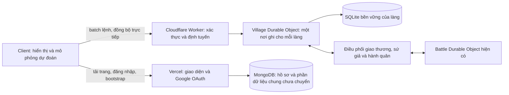

# Kế hoạch giảm CPU và thử chuyển backend làng sang Cloudflare

Ngày lập/cập nhật: 07/11/2026. Trạng thái: **Chặng A đã push/phát hành với delay off;
chưa bật canary 10 giây, chưa triển khai migration**. Runbook: [sync-release.md](./sync-release.md).

## 1. Mục tiêu và cách ra quyết định

Giảm chi phí xử lý khi người chơi online, giữ nguyên gameplay: tốc độ sản xuất,
tiêu hao, thời gian xây/tuyển quân, khám phá, vận chuyển, thiên tai và chỉ huy combat.
Giữ tiến triển offline hiện có; không giao quyền quyết định tài nguyên cho client.

Không mặc định phải chuyển toàn bộ hệ thống. Triển khai theo hai chặng:

1. **Chặng A — tối ưu trên kiến trúc hiện tại:** hợp đồng đồng bộ, gom lệnh tối đa
   10 giây, lưu hàng đợi trên máy, giảm tải/ghi toàn bộ làng và refresh lặp.
2. **Chặng B — thử Cloudflare:** chỉ thực hiện migration production sau benchmark
   và sau khi Chặng A chưa đạt ngân sách với cùng tải. Có thể thử prototype local
   song song việc đo Chặng A, nhưng prototype không nhận quyền ghi production.

Nếu Chặng A đạt cả ngân sách và độ ổn định thì dừng, chưa cần Chặng B.
Thay đổi phương án hoặc vượt gate phải ghi lại bằng số liệu; không mở rộng ba
thời đại tiếp theo trong phạm vi tối ưu này.

## 2. Số đo đầu vào và giới hạn của ước tính

Snapshot Production 6 giờ đã xem trong phiên làm việc ngày 07/11/2026; số làm tròn.
Đây không phải lần đo mới lúc viết tài liệu và chưa có baseline trước/sau cùng tải.

| Nhóm | CPU / 6 giờ | Tỷ trọng gần đúng |
|---|---:|---:|
| `/api/city/action` | 8 phút | 55% |
| `/api/city` | 3 phút | 21% |
| `/api/battles/reconcile` | 2 phút | 14% |
| API còn lại | 1,6 phút | 11% |
| Tổng | 14,6 phút | 100% do làm tròn |

Ở tốc độ này: `14,6 phút × 4 × 30 / 60 ≈ 29,2 giờ CPU/tháng`.
Để dưới 4 giờ cần giảm khoảng 86,3%. Mục tiêu vận hành riêng game là **không quá
2 giờ CPU/tháng quy đổi**, còn dư cho dao động và các project dùng chung team.
Nếu phần còn lại của team không còn đủ quota thì game đạt mục tiêu riêng cũng
không chứng minh cả team nằm trong free.

Các phép tính loại trừ dưới đây **không phải dự báo đã kiểm chứng**:

| Giả định | Phần CPU còn lại quy đổi |
|---|---:|
| Bỏ được toàn bộ CPU action + tải làng trên Vercel | 7,2 giờ/tháng |
| Bỏ thêm toàn bộ CPU đối soát định kỳ trên Vercel | 3,2 giờ/tháng |

Chưa cộng chi phí bootstrap, đồng bộ dữ liệu chung, backup, telemetry và vận hành
kiến trúc mới. Không dùng các con số này làm điều kiện nghiệm thu một mình.
Không trộn wall time, số lệnh, CPU client, CPU Worker và Fluid Active CPU Vercel.
Usage đã tiêu trong kỳ không được hoàn lại khi tối ưu.

## 3. Kiến trúc đích nếu Chặng B được thông qua

- Client cập nhật ngay. Batch có deadline 10 giây từ lệnh đầu tiên; không có lệnh
  thì không có request lưu rỗng. Tương tác quan trọng chủ động gửi ngay lệnh chờ.
- Server kiểm tra từng lệnh có thứ tự, lưu bền vững rồi mới xác nhận đã lưu.
- Một làng chỉ có **một nơi có quyền ghi**: Mongo ở giai đoạn cũ hoặc DO sau khi
  chuyển. Bản sao để đọc/backup không được tự nhận quyền ghi.
- Làng không có lệnh hoặc sự kiện cần xử lý thì được ngủ. Không đặt vòng lặp
  100 ms/1 giây cho mỗi làng. Thời gian tiến triển tính bù bằng engine hiện có.
- Combat hiện có vẫn ở Battle DO. Không đổi cơ chế chỉ huy để giảm CPU Vercel.
- Trình duyệt gọi Worker trực tiếp; không đặt proxy Vercel trước mỗi lệnh game.
- Không dùng client làm nơi duy nhất lưu làng. Không nhận số dư tài nguyên tự khai.
- Không thay Mongo bằng SQLite trong một lượt. Mọi phần ghi tài nguyên/quân phải
  đi qua bộ định tuyến quyền ghi, kể cả callback combat, chợ và cron cũ.

## 4. Hợp đồng đồng bộ bắt buộc

Một batch cần nhận diện tài khoản/làng, phiên chơi, phiên bản engine, revision,
thứ tự lệnh và mã chống xử lý trùng. Không tin ID làng hoặc mốc giờ do client tự khai.

Các nguyên tắc cần chốt ở task T01 trước khi code batch:

1. Phân biệt **đã nhận trên máy**, **đang gửi** và **server đã lưu**. UI không bị
   khóa suốt 10 giây chỉ vì đang chờ lưu.
2. Thứ tự tăng liên tục; lệnh bị từ chối cũng có kết quả cuối cùng. Mất ACK hoặc
   gửi lại không áp dụng lệnh hai lần. Receipt cũ được rút gọn nhưng high-water
   sequence vẫn ngăn replay; không chỉ dựa vào 64 receipt hiện có.
3. Hàng đợi IndexedDB gắn với tài khoản, làng, phiên và engine version. Phiên cũ
   không tự chuyển lệnh sang phiên mới. Không xóa lệnh còn chưa rõ kết quả.
4. Mốc 10 giây là deadline khi tab chạy bình thường, không phải đảm bảo của timer
   khi hệ điều hành treo tab. Khi foreground/reconnect phải tự kiểm tra và phục hồi.
5. Thời gian trong batch phải được giới hạn theo mốc server đã cấp. Không lùi
   checkpoint đã commit hoặc tin đồng hồ client tùy ý. Không cộng thêm 10 giây
   trễ cho mỗi lượt xây/thu hoạch do server xử lý theo giờ nhận gói.
6. Khi checkpoint đã tiến qua lệnh chờ hoặc có sự kiện ngoài làng, trả kết quả
   xung đột rõ ràng rồi khôi phục theo state chính thức; không âm thầm ghi đè.
7. Trước mua/bán, xuất quân, cử sứ giả hoặc bàn giao sang combat: flush lệnh chờ,
   chờ ACK rồi kiểm tra/quyết định từ server. Bị đánh là sự kiện server, không chờ
   máy phòng thủ online hoặc trả lời mới được bắt đầu trận.
8. Nếu mất mạng lâu, tiến triển offline vẫn tính theo luật hiện có. Lệnh tương tác
   chưa được server nhận không được mặc định hợp lệ chỉ vì đã nằm trên máy.
9. Chặn một trình duyệt hoạt động mỗi tài khoản. Các tab dùng cùng cookie vẫn là
   cùng phiên; phải có một tab gửi lệnh hoặc cơ chế phối hợp để không trùng sequence.

## 5. Danh sách task và thứ tự

Description, acceptance criteria, test và rollback chi tiết nằm trong
[cloudflare-migration-tasks.md](./cloudflare-migration-tasks.md).

| Task | Nội dung | Phụ thuộc | Trạng thái |
|---|---|---|---|
| T00 | Baseline, workload và ngân sách đo | Không | Có runner/so sánh local, profiler Mongo thật, HTTP/Worker, dashboard 1h/6h và deployment pin; còn production đại diện |
| T01 | Kiểm kê nơi ghi và chốt giao thức/timeline | T00 | Đã có `docs/sync-protocol.md`, đối chiếu bằng API/queue tests |
| T02 | Một phiên chơi, thu hồi quyền API/combat | Không | Web đã vào main; Worker đã deploy/probe 401; còn OAuth hai browser thật |
| T03 | Client batch 10 giây, IndexedDB, UX chờ lưu | T01, T02 | Harness và Game/Mongo thật qua giao dân, tuyển/reload, chợ, nhiều tab; còn mobile/soak thật hoàn tất/OAuth |
| T04 | Batch API, một lần load/save, giảm refresh/ghi thừa | T01, T02 | API tests và Mongo/HTTP/Worker tích hợp qua; profiler xác nhận 1 load/save; còn canary |
| G-A | Đo Chặng A, quyết định có cần migration | T03, T04 | Chưa đạt gate |
| T05 | Prototype Village DO và benchmark free thực tế | T00, T01 | Đang làm: SQLite local, batch/retry/rollback/restart và checkpoint catch-up; còn worst-case, cloud CPU/quota và stress. Xem `village-prototype.md` |
| T06 | Bộ định tuyến quyền ghi, migrator và fencing | T01, T05 | Chưa làm |
| T07 | Client kết nối Worker trực tiếp, phiên và reconnect | T02, T03, T05 | Chưa làm |
| T08 | Tích hợp giao thương, ngoại giao, chiến tranh | T04, T06, T07 | Chưa làm |
| T09 | Scheduler theo sự kiện thay quét định kỳ | T06, T08 | Chưa làm |
| T10 | Backup, restore, rollback và engine version | T06, T08, T09 | Chưa làm |
| G-B | Kiểm thử đầu cuối, lỗi mạng và quota | T05–T10 | Chưa đạt gate |
| T11 | Canary production, đối chiếu trước/sau | G-A yêu cầu chuyển; G-B đạt | Chưa làm |
| T12 | Mở rộng, giám sát và chốt nghiệm thu | T11 | Chưa làm |

Không triển khai migration production nếu T08 hoặc T10 chưa xong. Một prototype
làng chơi được chưa đủ chứng minh chợ, combat hoặc rollback đã an toàn.

## 6. Tiêu chí đo và điều kiện hoàn thành chung

### Tính đúng

- Không mất/nhân đôi tài nguyên, quân, dân, hàng ký gửi, thuyền hoặc kết quả combat
  trong toàn bộ test bắt buộc và canary. Sai lệch không giải thích được: chặn release.
- Cùng trạng thái đầu, thời gian và chuỗi lệnh hợp lệ: engine cho cùng kết quả có ý
  nghĩa gameplay. Trường chẩn đoán/transport được loại khỏi checksum có tài liệu.
- Các mốc sản xuất, tiêu hao, xây, tuyển quân, hành quân, thiên tai và offline cap
  giữ nguyên. Lưu theo đợt không làm mất 10 giây lao động sau mỗi batch.
- Không bị chặn điều khiển 10 giây; mục tiêu phản hồi hình ảnh P95 <=100 ms trên
  bộ thiết bị/browser thử nghiệm được ghi tên, với thao tác không có lỗi nghiệp vụ.
- Trạng thái đã ACK sống qua restart/eviction. Chỉ một nơi có quyền ghi và một
  phiên chơi được gửi lệnh; sự kiện khác làng không dựa vào lời khai client.

### Độ ổn định

- Test có tình huống mất ACK, gửi trùng, đảo gói, dừng tiến trình giữa giao dịch,
  restart DO, quota/storage error, token hết hạn và phiên bị thay thế.
- Lỗi 5xx/timeout ngoài dự kiến <0,1% trên cửa sổ đo; không có lỗi toàn vẹn dữ liệu.
  Không tính từ chối hợp lệ do hết tài nguyên/phiên cũ vào lỗi hệ thống.
- ACK batch P95 mục tiêu <=1 giây sau khi bắt đầu gửi trên cấu hình mạng thử đã
  công bố; báo riêng 10 giây gom lệnh, latency mạng và thời gian xử lý server.
- Stress ít nhất 2 giờ và 100 chu kỳ reconnect: không tăng cache/hàng đợi vô hạn;
  có giới hạn số phần tử/byte và đồ thị bộ nhớ trước/sau warm-up.
- Canary ít nhất 48 giờ; có tối thiểu 24 giờ workload đủ các luồng chơi. Nếu thiếu
  người dùng thì bổ sung replay/load test, không coi ít traffic là thành công.

### Ngân sách free

- CPU Vercel riêng game quy đổi <=2 giờ/30 ngày tại workload chuẩn; báo thêm tổng
  team. Không chỉ so endpoint đã chuyển mà bỏ quên endpoint mới thay thế.
- Mỗi quota Cloudflare dùng tối đa 50% tại tải chuẩn và <=80% khi stress gấp đôi
  tải giờ cao điểm. Tải thực tế lặp lại đủ một ngày theo kịch bản, không suy từ
  một request nhỏ. Nếu mức đôi tải không nằm trong free: chưa đạt mục tiêu free.
- Báo riêng requests Worker/DO, duration DO, row reads/writes, storage, bandwidth,
  MongoDB và backup. Tính cả alarm, session fence, coordinator và telemetry.
- Ngân sách 50%/80% là tiêu chí nghiệm thu, không phải giới hạn do nhà cung cấp.
  Giới hạn thực tế phải được kiểm tra lại trước lúc phát hành.

Hoàn thành dự án khi đạt các tiêu chí trên bằng Chặng A hoặc bằng Chặng B,
release đã được xác minh, restore đã diễn tập và có báo cáo trước/sau cùng tải.
Không đánh dấu xong chỉ vì code đã merge, build xanh hoặc health endpoint trả 200.

## 7. Hạn mức và rủi ro cần theo dõi

Theo tài liệu Cloudflare đã đối chiếu ngày 07/11/2026: Durable Objects SQLite có
free 100.000 requests/ngày, 13.000 GB-s/ngày, 5 triệu row reads/ngày,
100.000 row writes/ngày và 5 GB lưu trữ tổng. Quota chia sẻ với các DO khác trong
account, gồm cả combat hiện có. Vượt quota free có thể làm thao tác thất bại.
Không suy từ gói Worker sang DO; T05 phải xác minh CPU/time limits của từng lớp.

Hibernation là điều kiện quan trọng: không chuyển vòng lặp mô phỏng liên tục
sang từng làng. Timer, I/O chờ, alarm và ghi SQLite đều có chi phí cần đo.
Gom lệnh giúp giảm overhead nhưng vẫn phải tính/kiểm tra từng lệnh.

Rủi ro lớn nhất là chuyển quyền ghi giữa hai nơi, timeline lệnh chờ khi bị đánh,
và giao dịch nhiều làng không có transaction chung. Cần fence, escrow và
inbox/outbox có chống trùng; không giả định nhiều DO có transaction atomic chung.

Nếu không đạt quota ở tải yêu cầu: báo rõ số đo và nguyên nhân, chưa mở rộng
canary. Đưa lựa chọn giảm chi phí kỹ thuật tiếp hoặc gói trả phí nhỏ cho người
chủ dự án quyết định; không tự nâng gói, bỏ tính năng hay giảm tốc độ gameplay.

## 8. Nguồn và tài liệu liên quan

- [Cloudflare Durable Objects pricing](https://developers.cloudflare.com/durable-objects/platform/pricing/)
- [Durable Objects limits](https://developers.cloudflare.com/durable-objects/platform/limits/)
- [WebSocket hibernation](https://developers.cloudflare.com/durable-objects/best-practices/websockets/)
- [Vercel Functions usage and pricing](https://vercel.com/docs/functions/usage-and-pricing)
- [Kiểm toán CPU trước đó](./runtime-stability.md)
- [Thống kê lệnh online và giới hạn số liệu](./online-command-statistics.md)
- [Cơ chế một phiên chơi và lưu ý phát hành](./single-session.md)

Không có tài liệu chính thức đã xác minh cho chu kỳ lưu làng của Clash of Clans.
Mốc 10 giây là quyết định thiết kế của game này, không phải thông số sao chép từ CoC.
