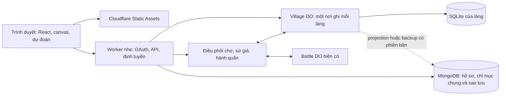

# Kế hoạch chuyển game khỏi Vercel sang Cloudflare

Ngày: 09/11/2026. Trạng thái: **web tĩnh đã có staging; chưa chuyển production**.

Worker web đã tạo: **`dongchaythoigian`**, origin
`https://dongchaythoigian.phungthienphu.workers.dev`.
Kiểm tra ngày 09/11/2026: HTTP 200, nội dung `Hello World!`; mới xác nhận
Worker mẫu hoạt động, chưa deploy website/API hoặc chuyển dữ liệu game.

Staging riêng: `https://dong-song-game-staging.phungthienphu.workers.dev`.
Web tĩnh đã build/deploy và kiểm tra HTTP + giao diện desktop/mobile. MongoDB
7.8 đã qua kết nối/CRUD/transaction trên Worker thật với database QA. Native
OAuth đã qua Google thật một browser; chưa nghiệm thu phiên hai browser/socket
hoặc gameplay.
Bằng chứng và lệnh chạy: [cloudflare-web-staging.md](./cloudflare-web-staging.md).

Tài liệu này thay hướng triển khai trong `cloudflare-migration-plan.md` và
`cloudflare-migration-tasks.md` ngày 07/11. Những tài liệu đó giữ làm lịch sử và
nguồn chi tiết giao thức, không phải bằng chứng đã hoàn thành migration.

## 1. Kết quả cần đạt

- Website, đăng nhập Google, API và scheduler game hoạt động không phụ thuộc
  Vercel. Dùng địa chỉ Cloudflare mới hoặc tên miền riêng.
- Giữ tài khoản, làng, vị trí thế giới, tài nguyên, quân, dân, công trình, kho,
  thuyền, quan hệ bạn bè, hàng ký gửi, đoàn xe, sứ giả và lịch sử tương tác.
- Client tiếp tục hiển thị và dự đoán ngay; server xác nhận các thay đổi tài sản.
  Không biến save do client tự khai thành dữ liệu có quyền giao thương/PvP.
- Các làng và trận đánh độc lập chạy đồng thời; cùng một làng có một nơi ghi,
  xử lý theo thứ tự, có chống trùng. Không chia mỗi dân/tài nguyên thành một Worker.
- Đạt ngân sách Free tại tải đã đo. Nếu không đạt, báo nguyên nhân và lựa chọn
  trước khi mở production; không tự nâng gói hoặc giảm tốc gameplay để vừa quota.

**Phạm vi giữ nguyên:** luật kinh tế/cân bằng, mang tài nguyên về kho, diễn biến
offline và cap hiện có, thiên tai, bản đồ, tuyển quân và chỉ huy combat. Tối ưu
engine theo sự kiện có bước riêng, so kết quả trước khi kích hoạt.

## 2. Điểm xuất phát và thứ tự chuyển

- Web hiện là Next.js 16.4.5, MongoDB driver 7.8; làng thật lưu MongoDB.
- Battle Worker đang có tên `dong-song-battles`; còn callback/cron về Vercel.
- `dong-song-village-prototype` chỉ dành cho dữ liệu giả, không đổi thành kho
  production bằng cách bật cờ hoặc đổi URL frontend.
- Đã có batch 10 giây, queue/ACK/receipt, tối ưu đường đi và cache; tái sử dụng.
  Preflight mới đọc/checksum, chưa có bàn giao quyền ghi thật.
- Vercel đã bị pause trong lần kiểm tra 08/11. Không thiết kế rollback hoặc
  scheduler mới dựa vào việc Vercel chắc chắn mở lại.
- Tám làng là số đếm ở snapshot 08/11, phải kiểm kê lại trước chuyển.

Ưu tiên dựng nhà mới và kiểm thử bằng dữ liệu giả, rồi chuyển dữ liệu cùng một
đợt bảo trì. Quy mô hiện nhỏ nên **không xây chế độ production hỗn hợp một số
làng Mongo và một số làng DO** trong lần này. Nó sẽ làm giao thương/PvP phức tạp
hơn đáng kể. Tất cả làng chuyển ownership cùng epoch; mở truy cập sau khi cả
tập dữ liệu và quan hệ đã đối soát. Nếu quy mô kiểm kê mới làm cách này không
phù hợp, sửa kế hoạch trước khi viết migrator, không tự chuyển từng làng.

## 3. Kiến trúc đích

- Ưu tiên phục vụ giao diện game bằng file tĩnh, tái sử dụng các component React,
  canvas, sprite và engine client; không chạy SSR cho mỗi lần người chơi mở game.
- M01 chốt build tĩnh riêng bằng Next static export hay Vite sau một spike nhỏ.
  API hiện tại dùng cookie/POST/dữ liệu động nên không thể chỉ bật `output: export`
  cho nguyên app rồi coi là xong. Không nâng framework hoặc đổi sang beta mặc định.
- API worker dùng Request/Response và bindings, tách business logic khỏi
  `next/headers`, `next/server`, `after()` và env của Node.
- Giữ MongoDB cho dữ liệu chung trong đợt đầu. M02 phải chứng minh kết nối
  Workers/driver thực sự chạy được. Không mặc định Node compatibility là đủ.
  Nếu không đạt, dừng gate này và chốt phương án dữ liệu chung thay thế bằng số
  đo; chưa chuyển user và không âm thầm mở thêm dịch vụ có phí.
- Village DO production là namespace mới. Không đổi tên/xóa namespace Battle
  hiện có; không import fixture QA hoặc secret prototype vào production.
- DO lưu bền vững state/ledger trước ACK; nghỉ khi không có việc cần chạy.
  Các mốc chuyến đi/xây dựng tới hạn được tính cùng batch/checkpoint/sự kiện,
  không tạo một alarm hoặc request cho mỗi bước chân.

## 4. Tài nguyên cần chuẩn bị và người thực hiện

| Tài nguyên | Cần làm | Ai làm |
|---|---|---|
| Worker web/API mới | Đã tạo `dongchaythoigian`, URL ở đầu tài liệu; hiện chỉ chạy Hello World | Chủ dự án đã tạo; agent triển khai code sau các gate bên dưới |
| Worker thử tích hợp | `dong-song-game-staging`, tài khoản/DB giả riêng | Agent tạo khi có cấu hình code |
| Village DO và coordinator production | Bindings/class/SQLite migrations trong Wrangler; tên cuối ghi trong M03 | Agent cấu hình/deploy, không yêu cầu tạo DO thủ công |
| Battle Worker | Giữ nguyên dữ liệu/namespace, đổi callback và lịch đối soát ở cutover | Agent; cần tài khoản Cloudflare đã đăng nhập |
| MongoDB | Giữ cụm và database hiện tại; staging dùng DB riêng; quyền kết nối được kiểm chứng ở M02 | Agent cấu hình, chủ dự án hỗ trợ đăng nhập nếu cần |
| Google OAuth | Thêm callback chính xác của URL web mới, giữ callback cũ trong thời gian chuyển | Chủ dự án hoặc agent khi đã có phiên được phép truy cập |
| Tên miền riêng | Không bắt buộc, ban đầu có thể dùng `workers.dev` | Chủ dự án chọn nếu muốn |
| Backup | Chốt nơi lưu, retention, khả năng replay và ngân sách ở M08 | Agent thiết kế; không tự bật R2/trả phí |

Env/secret dự kiến cho Worker web/API: `APP_URL`, `GOOGLE_CLIENT_ID`,
`GOOGLE_CLIENT_SECRET`, `AUTH_SECRET`, `MONGODB_URI`, `MONGODB_DB`,
`BATTLE_WORKER_URL`, `BATTLE_SERVER_SECRET`, `CITY_BATCH_ENABLED=true`.
Bindings DO là cấu hình Wrangler, không phải chuỗi URL bỏ vào frontend.
Tên cờ bảo trì/ownership/scheduler được chốt trong code M03/M07.

Chỉ nhập secret trong Cloudflare Secrets hoặc CLI an toàn, không gửi vào chat,
repo, client bundle, URL hoặc ảnh chụp. Chưa cần nhập secret vào Worker Hello
World: endpoint game chưa tồn tại và code migration chưa được deploy.

## 5. Các task, phụ thuộc và điều kiện hoàn thành

Mỗi task code có commit riêng kèm bằng chứng local/staging/production. Bảng này
là backlog mới, không đánh dấu các task cũ hoàn thành chỉ vì có prototype.

| ID | Nội dung | Phụ thuộc | Trạng thái |
|---|---|---|---|
| M00 | Kiểm kê, baseline và bộ workload | Không | Có tài liệu/số đo lịch sử, cần cập nhật |
| M01 | Build giao diện tĩnh và router API | M00 | Đã kiểm tra staging; API gameplay khóa |
| M02 | Google OAuth, phiên và kết nối Mongo trên Workers | M00, M01 cho luồng browser | Mongo/transaction/repository và Google thật một browser qua; hai browser/socket fence chưa nghiệm thu |
| M03 | Village DO production, fencing và giao thức batch | M00, hợp đồng M02 | Có prototype/preflight để tái sử dụng |
| M04 | Tối ưu engine theo sự kiện, có version gate | M00 | Chưa làm; chạy độc lập với đổi hosting |
| M05 | Chợ, sứ giả, hành quân và kết quả combat | M02, M03 | Business logic cũ có, coordinator mới chưa làm |
| M06 | Client trực tiếp, thông báo sự kiện và phục hồi | M01–M03, M05 | Queue cũ có, kết nối mới chưa làm |
| M07 | Scheduler và ngắt phụ thuộc Vercel | M03, M05 | Chưa làm |
| M08 | Migrator toàn bộ, backup/restore và rollback | M02, M03, M05, M07 | Có preflight chỉ đọc |
| M09 | Kiểm thử đầu cuối và gate ngân sách Free | M01–M08 | Chưa đạt |
| M10 | Chuyển production trong cửa sổ bảo trì | M09 | Chưa làm |
| M11 | Theo dõi, nghiệm thu và ngừng project game trên Vercel | M10 | Chưa làm |

### M00 — Kiểm kê và đo đúng bản hiện tại

Chốt commit, schema/engine, mọi writer, callback, cron, env names và các relation
của làng. Đọc Mongo trực tiếp ở chế độ chỉ đọc; không import helper tự tạo index.
Thu fixture tổng hợp: làng mới, 50/200/300/700 dân, 96×96, nhiều công trình,
kho đầy, đói, ruộng tự chăm, đổi dòng sông và 1h/24h/14 ngày/>14 ngày offline.
Tải online phải có xây/tuyển/điều dân, chợ, sứ giả, xem làng và combat.

**Xong khi:** có inventory writer và workload cố định, số hiện tại tách khỏi số
Vercel lịch sử trộn deployment; xác định tải chuẩn và peak. Không lấy benchmark
chức năng, wall time hoặc CPU Node làm billed CPU Cloudflare.

### M01 — Website tĩnh và API chạy thử trên Workers

Tách build web game khỏi route API/QA. Giữ màn đăng nhập, fonts, icon, OG image,
canvas, responsive và đường dẫn asset. Chốt Next static build riêng hoặc Vite
theo mức tái sử dụng và chi phí kiểm thử, không thực hiện cả hai migration.
Worker trả JSON cho `/api/*`, không để SPA fallback trả HTML cho lỗi API.

**Xong khi:** URL staging tải đúng chunk/MIME và giao diện desktop/mobile; secret
không vào bundle; `/dev/*` và helper QA không xuất hiện production. Chưa cho
đường API stub nhận hoặc báo ACK lệnh game thật. Rollback bằng artifact staging cũ.

### M02 — Đăng nhập và dữ liệu chung

Kiểm chứng Mongo 7.8 trên workerd thật: DNS/TLS/SRV theo URI thực, CRUD/transaction
cần dùng, connection lifecycle, cold start và timeout. Test ghi chỉ dùng DB QA.
Port cookie/OAuth/session sang runtime Workers; giữ Google `sub` → user → cityId,
friend code và phiên một máy. Web/API cùng origin để đơn giản cookie.

**Xong khi:** Google OAuth thật trên staging; tài khoản QA cũ vào đúng làng,
đăng nhập máy B khóa cả HTTP/socket máy A, logout A không khóa B; origin/CSRF và
cookie được kiểm thử; không cần Vercel xác thực mỗi lệnh. Không reset `users`.

### M03 — Nơi ghi duy nhất cho mỗi làng

Tách lớp domain khỏi Next, tái sử dụng timeline/batch/anchor/ACK/sequence hiện có.
DO lưu state, checkpoint, receipt, epoch, revision, phiên và inbox/outbox bền vững.
Thêm global manifest cutover; tất cả writer Mongo cũ phải kiểm tra fence và
không commit được sau bàn giao. Client không được tự chọn backend/epoch.

**Xong khi:** batch thường chỉ một commit state/ledger, duplicate không thực thi
lại, restart giữ ACK. Request cũ đang chạy, callback, hai lần migration và quota
storage lỗi đều không tạo hai owner. Hoàn thành trên dữ liệu QA trước.

### M04 — Engine theo mốc sự kiện, không đổi luật chơi

Đây là task thuật toán riêng. Giữ engine hiện tại làm oracle cho differential
test; không chạy hai engine trên mọi request production để so vì sẽ tăng CPU.
Tối ưu lần lượt các khoảng không có thay đổi, tìm đường, vận chuyển và kinh tế.
Tính đúng mốc thu thập/xuống hàng, kho đầy, ngắt việc, tiêu hao, đói/sinh dân,
ruộng bạc màu/tự chăm, đổi địa hình và thiên tai. Không tính trước tài nguyên
chưa về kho. Client dựng chuyển động giữa các mốc.

**Xong khi:** cùng seed, timeline, lệnh và sự kiện cho cùng kết quả gameplay;
chia nhỏ thời gian/reload/catch-up không lệch. Có CPU và số event trước/sau ở
toàn bộ workload M00, engine version và rollback tương thích. Nếu engine cũ
đã đạt ngân sách thì có thể chuyển hosting trước, giữ M04 cho release riêng;
nếu chưa đạt, M04 là điều kiện bắt buộc trước M09/M10. Không bỏ task khỏi báo cáo.

### M05 — Tương tác nhiều làng và combat

Port đăng/mua/hủy hàng, escrow, đoàn xe/cướp/hộ tống, sứ giả/thăm/chia sẻ vị trí,
quân/lương/thuyền xuất đi và về, battle snapshot/result/thiệt hại. Chọn coordinator
và operation ID; reservation/commit/compensation đều có inbox/outbox chống trùng.
Tài sản làng chỉ đổi qua Village DO, không qua Mongo projection.

**Xong khi:** kill/retry/mất ACK ở từng bước không nhân đôi hoặc mất tài sản;
không có lock vĩnh viễn. Combat vẫn điều khiển được và kết thúc có báo cáo,
người offline vẫn được xử lý. Test với hai làng QA, không tấn công làng thật để QA.

### M06 — Đồng bộ client và giảm polling còn sót

Giữ batch 10 giây và optimistic feedback. Thay refresh đều city/me/diplomacy,
visit 5 giây, market fighting 2 giây và gia hạn socket gây tải thừa bằng sự kiện,
revision/delta, deadline và reconnect/foreground recovery phù hợp. Giữ kiểm tra
phiên một máy; gia hạn không tải lại full game chỉ để lấy ticket.

**Xong khi:** trạng thái Chờ lưu/Đã lưu/Mất mạng chính xác; không request batch
rỗng; mạng bị đứt/thiếu event vẫn khôi phục được. Có trace idle/active/hidden,
không hứa không có request nào vì auth/keepalive vẫn có ngân sách riêng.
Tài khoản/thế giới/sứ giả vẫn cập nhật đúng quyền và diễn hoạt mượt.

### M07 — Scheduler không gọi ngược Vercel

Đổi callback/cron hiện tại thành lịch job đến hạn có ID/epoch/retry hữu hạn.
Giữ reconcile dự phòng có giới hạn, không settle tất cả làng mỗi phút.
Tránh vòng retry nóng khi kho đầy, API tạm lỗi hoặc token hết hạn. Battle DO chỉ
giữ interval lúc đang có trận; cần ngủ khi xong hoặc không có việc.

**Xong khi:** network trace cả lượt game/combat/scheduler không gọi Vercel;
sự kiện vẫn tới đúng hạn và mất callback được phục hồi. Old cron/callback bị
fence không nhận quyền ghi lại. Không dùng ngắt cron để bỏ xử lý đoàn xe đang đi.

### M08 — Chuyển dữ liệu và diễn tập khôi phục

Mở rộng preflight hiện tại: helper cũ chặn quan hệ đang hoạt động, không đủ để
chuyển cả hệ thống. Manifest phải bao gồm users/cities, orders, caravans,
battles, envoy visits, discoveries, receipts, clocks, jobs và các projection cần
thiết. Bảo toàn chuyến đang đi/kết quả chờ xử lý, không xóa relation để vượt gate.
Job tới hạn sau downtime được reconcile đúng một lần theo luật thời gian cũ.

**Xong khi:** export/import idempotent có checksum toàn bộ quan hệ, resume khi
dừng giữa chừng; restore thử giữ state/ACK/escrow. Crash/restart sau ACK có RPO=0.
Đối với mất storage hoặc lỗi logic diện rộng: thiết kế checkpoint + journal có
thể replay; chỉ cam kết RPO=0 nếu journal cần thiết cũng đã lưu bền vững trước
ACK và đã tính chi phí. Nếu chỉ backup định kỳ, phải nêu khoảng mất dữ liệu tối
đa và có quyết định rõ trước release, không tự mặc định được mất state đã ACK.
Mục tiêu restore cửa sổ chuyển ban đầu <=30 phút, đo bằng dry-run.

Rollback sau khi DO đã nhận ghi phải lấy checkpoint/ledger mới nhất và fence
owner trước khi đổi. Web/processor dự phòng chạy trên Cloudflare bằng artifact
đã kiểm thử; không mặc định URL Vercel đã pause sẽ phục vụ được. Giữ Mongo làm
nguồn đối chiếu/backup không đồng nghĩa được ghi snapshot Mongo cũ đè lên DO.

### M09 — Gate tính đúng, độ ổn định và Free

- Chạy regression API/engine/Worker và browser hai tài khoản QA, mobile thật,
  mất mạng/mất ACK, đa tab/đa máy, restart/deploy và giao dịch nhiều làng.
- Stress thực >=2 giờ, >=100 reconnect; test gấp đôi peak workload M00;
  quan sát staging >=48 giờ và ít nhất 24 giờ workload có các luồng cần thiết.
- Phản hồi local P95 <=100 ms; ACK P95 <=1 giây sau lúc bắt đầu gửi trên mạng
  thử đã công bố, tách 10 giây gom lệnh khỏi latency. Catch-up dài báo tiến độ,
  đo riêng, không dùng nó để khóa/treo mọi làng.
- Không sai tài sản/quân/ACK; 5xx/timeout ngoài dự kiến <0,1%. Queue/cache hữu
  hạn, không có memory tăng không giới hạn trong phép thử đã ghi.
- Mỗi quota account Cloudflare <=50% tại tải chuẩn, <=80% khi gấp đôi peak.
  Tính Worker/DO requests, session checks, alarms, duration, rows, storage,
  backup/journal, MongoDB và Battle Worker đang có. CPU router phải nằm trong
  giới hạn Free thực tế, không áp nhầm giới hạn DO cho router.

**Không đạt:** chưa chuyển production, công bố số thiếu và phần cần tối ưu.
Không lấy trang chủ 200, build xanh hoặc ít người dùng làm bằng chứng đủ Free.

### M10 — Cutover production có thể phục hồi

1. Chốt artifact/engine/config, URL, OAuth, manifest version và cửa sổ bảo trì
   theo dry-run. Backup dữ liệu hiện tại trước mọi mutation migration.
2. Dừng tiếp nhận mutation mới ở mọi đường cũ, fence scheduler/callback và
   đợi/đối soát request đang chạy. Không chỉ đóng giao diện mà để cron vẫn ghi.
3. Chốt snapshot nhất quán và epoch. Import cả tập dữ liệu vào namespace mới,
   kiểm tra checksum, số lượng, quan hệ và tổng tài sản/escrow; chưa mở ghi.
4. Chuyển quyền ghi toàn hệ thống một lần qua manifest, đổi Battle callback
   sang endpoint mới tương thích. Đảm bảo callback cũ retry vẫn chống trùng.
5. Reconcile các job đến hạn, smoke test đăng nhập/đúng làng/safe action của
   tài khoản được phép. Mở tất cả người chơi khi đạt; không chỉ Nam Quốc Sơn Hà.
6. Theo dõi chặt >=48 giờ, không triển khai đồng thời thay đổi cân bằng/đời mới.

**Queue khác origin:** cookie/IndexedDB của `.vercel.app` không tự sang domain
mới. M02/M06 phải có phương án lấy/đối chiếu queue còn local nếu truy xuất được
origin cũ, phân loại ACK/uncertain và không replay dưới phiên mới tùy ý. Nếu
Vercel pause làm không thể truy xuất queue, báo giới hạn cụ thể; không xóa queue,
không nhận save/tài nguyên tự khai để bù. State server đã ACK phải giữ nguyên.

**Thời gian trong bảo trì:** giữ timestamp và offline cap theo luật hiện tại;
không tự reset `last`, tặng/bớt tài nguyên hoặc dừng sức ăn bằng tay.
Sai checksum, hai owner, mất ACK hoặc lỗi tài sản: giữ bảo trì, dừng rollout và
chạy runbook M08. Không có rollback chỉ bằng một cờ đổi URL.

### M11 — Nghiệm thu và ngừng phụ thuộc Vercel

Sau 7 ngày đủ tải: báo cáo version/epoch, tính đúng, request/CPU/duration/rows,
restore drill và ngân sách còn lại. Gỡ cron, callback, webhook deploy và URL
Vercel còn sót trong riêng project game khi không còn job hoặc queue cần xử lý.
Giữ backup theo retention đã chốt, không xóa team Vercel hoặc project khác.
MongoDB tiếp tục là dịch vụ ngoài Cloudflare cho tới một kế hoạch dữ liệu riêng.

**Xong khi:** không còn request vận hành bắt buộc tới Vercel, tất cả tài khoản
vào đúng làng trên URL mới, restore có bằng chứng, quota có headroom và runbook
đủ để người khác thực hiện. Ghi riêng phần nào chưa đạt, không gọi là xong Free
nếu chỉ đạt tính năng hoặc phải dùng gói trả phí.

## 6. Các việc có thể làm song song

Đây là song song giữa các luồng backend/công việc, không làm tăng quota account:

- M01 giao diện/API adapter và spike Mongo của M02 có thể tiến triển độc lập.
- M04 tối ưu engine dùng fixture chạy độc lập với dựng hạ tầng M01–M03.
- M05/M06/M07 chỉ làm độc lập sau khi hợp đồng M03 đã chốt; mock không thay QA
  tích hợp. Cutover/fencing/import/activation là các bước có thứ tự bắt buộc.

Không đặt deadline mở game trước khi M02, M08 và M09 có kết quả. Báo tiến độ
theo task và bằng chứng, không dùng thời gian đã làm để thay điều kiện hoàn thành.

## 7. Hướng dẫn chủ dự án tạo Worker web trước

**Có thể làm ngay, chưa phải deploy game hoàn chỉnh:**

**Đã hoàn thành bước tạo Worker.** Dùng Worker `dongchaythoigian` hiện có,
không tạo thêm `dong-song-game`. Các bước tạo dưới đây giữ để tham khảo.

1. Đăng nhập [Cloudflare dashboard](https://dash.cloudflare.com/), chọn account
   đang có `dong-song-battles` và `dong-song-village-prototype`.
2. Vào **Workers & Pages → Create application**.
3. Chọn đường tạo Worker **Hello World / Start with Hello World** (nhãn có thể
   thay đổi). Đặt tên **`dong-song-game`** rồi **Deploy** mẫu.
4. Mở URL `https://<tên-worker>.<subdomain-account>.workers.dev`, kiểm tra trang
   mẫu hoạt động và gửi URL thực tế. Không đoán URL từ tên hiển thị account.
5. Giữ Free ở bước này. Chưa cần bật Paid, kết nối GitHub, nhập build command,
   thêm D1/R2 hoặc tự tạo Durable Object.
6. Chưa nhập secret. Khi M01–M03 có code/config, deploy bằng Wrangler sẽ thay
   Hello World và tạo bindings/migrations đúng namespace.

URL mẫu hoạt động không có nghĩa Google OAuth/API game đã sẵn sàng. Sau khi chốt
URL web mới, callback cần thêm trong Google Cloud Console là
`https://<địa-chỉ-web-mới>/api/auth/callback/google`. Đây là Authorized redirect
URI; Authorized JavaScript origins nếu dùng thì chỉ là origin, không kèm path.
Chỉ test đăng nhập khi route callback mới đã deploy.

Với URL đã tạo, thêm Authorized redirect URI sau trong Google OAuth client
đang dùng cho game (giữ callback Vercel hiện có):
`https://dongchaythoigian.phungthienphu.workers.dev/api/auth/callback/google`.

Hai Worker hiện có giữ nguyên ở bước chuẩn bị. Lệnh deploy hiện tại với
`worker/wrangler.jsonc` là **deploy combat**, không phải deploy website mới.
Chưa có file cấu hình web production để đưa ra một lệnh deploy game dùng ngay.

## 8. Tài liệu đối chiếu

- [So sánh Free, benchmark hiện tại và mô hình request](./hosting-free-comparison-2026-11-09.md)
- [Sự cố Vercel và số liệu production lịch sử](./incident-vercel-pause-2026-11-08.md)
- [Giao thức queue/batch/ACK đã có](./sync-protocol.md)
- [Prototype cloud và giới hạn kiểm chứng](./village-cloud-validation.md)
- [Preflight hiện tại và các blocker](./village-preflight.md)
- [Runbook phát hành đồng bộ đã làm](./sync-release.md)
- [Workers pricing](https://developers.cloudflare.com/workers/platform/pricing/)
- [DO pricing](https://developers.cloudflare.com/durable-objects/platform/pricing/)
