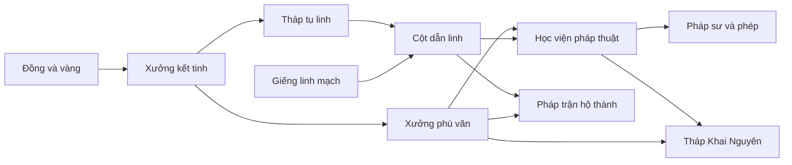

# Spec thời đại 7–9 — Thức tỉnh, Nguyên tố, Thần thoại

Bản thiết kế công nghệ–ma pháp v3, ngày 10/11/2026. **Đề xuất sản phẩm, chưa triển khai gameplay.** Kế thừa game xây làng sáu đời trước; phép thuật xuất hiện từ thời 7 rồi ảnh hưởng tăng dần ở thời 8 và 9. Không thay toàn bộ thành phố bằng game fantasy hoặc bỏ chuỗi kinh tế/công nghệ cũ. Các số là baseline cần mô phỏng/playtest. Đọc kèm `eras-7-9-review.md`.

## 1. Trải nghiệm và phạm vi

Sau Hiện đại, thành phố phát hiện linh mạch Sông Mẹ. Đại học và công nghiệp giúp hiểu, chế tác và khai mở ma pháp; làng dần học phép, xây pháp trận, nuôi linh thú và mở cổng triệu hồi. Nông dân vẫn trồng trọt, công nhân vẫn chế tác, quân đội thường vẫn là lực lượng nền. Nhà hiện đại và quân cũ vẫn có vai trò, không bị đổi skin thành phép hoặc xóa đầu tư.

| Thời | Tên | Việc người chơi thực sự làm | Quy mô tham khảo | Kỳ quan |
|---|---|---|---|---|
| 7 | **Thức tỉnh Ma pháp** | Khai mở linh mạch, nuôi mạng mana, luyện phù văn, tuyển pháp sư và phòng chống zombie bằng phép | 450–650 dân | Tháp Khai Nguyên |
| 8 | **Vương triều Nguyên tố** | Phối hợp Hỏa–Thủy–Mộc–Thổ, chọn trường phái, tạo golem và linh thú | 650–850 dân | Đại Trận Tứ Linh |
| 9 | **Kỷ nguyên Thần thoại** | Điều phối cổng giới, khế ước thần thú, đại phép có chuẩn bị và lãnh địa ma pháp | 850–1.100 dân | Thiên Cung Sông Mẹ |

Nhịp mục tiêu 7–10 / 10–14 / 14–21 ngày mỗi thời, chơi 2–3 phiên/ngày. Đây là mục tiêu đo trải nghiệm, không khóa thời gian. Chiến thuật đến từ phối hợp, vị trí và nguồn lực; không cần mở app mỗi 15 phút để chống zombie.

### 1.1. Mức ảnh hưởng phép thuật tăng dần

| Thời | Công nghệ/nền làng kế thừa | Vai trò ma pháp | Giới hạn thiết kế |
|---|---|---|---|
| 7 — Thức tỉnh | Nhà máy, điện, đại học, bệnh viện, nông nghiệp, lính súng/thiết giáp vẫn chủ đạo | Một cụm thử nghiệm linh mạch, pháp sư hỗ trợ, phép nhỏ và chữa dịch | Không yêu cầu thay toàn bộ quân/công trình bằng ma pháp; không có thần thú hay đại phép |
| 8 — Nguyên tố | Cơ khí chế tác vật dẫn, nhà máy cung cấp kim loại/than, y tế và hậu cần thường nuôi cụm phép | Bốn nguyên tố tạo cách bố trí và đội hình mới, golem/linh thú bắt đầu nổi bật | Đội hình kết hợp có giá trị; phép không tự lo toàn bộ thực phẩm, vận tải và phòng thủ |
| 9 — Thần thoại | Thành phố vẫn cần điện, công nhân, kho, đường, quân và sản xuất thường | Ma pháp tác động chiến trường/lãnh địa, thần thú, cổng và vận tải phép | Phép là sức mạnh lớn nhưng đắt, có đối trọng và thời gian chuẩn bị; không bỏ luật phá nhà hoặc xây lại |

Giữ các vai trò dân làng, nông dân, công nhân và binh lính; phép mở thêm nghề, không biến tất cả thành pháp sư. Dòng sông, ruộng, nhà cổ và phố hiện đại còn nhìn thấy bên cạnh khu phép. Công trình cũ không tự tăng cấp/đổi loại khi lên thời.

**Nhánh công nghệ đã dự kiến:** dầu, chip, xe tăng, tiêm kích, radar và phát triển quỹ đạo vẫn nằm trong hướng mở rộng sản phẩm, không xóa ý tưởng hoặc art. Bản này chốt chi tiết tuyến ma pháp; nhánh công nghệ bổ sung phải có spec tương thích trước khi bật, không coi toàn bộ v1 đã bị thay hoặc tự phát hành mọi hệ cùng lúc. Xe thiết giáp/quân súng hiện có giữ nguyên. Quỹ đạo và cổng linh giới là hai chức năng riêng, không đổi tên tàu thành thần thú.

### 1.2. Chuỗi cũ trực tiếp nuôi chuỗi mới

- Xưởng kết tinh cần một xưởng dụng cụ/forge hoạt động trong 6 ô và đường dân sự nối tới; luyện phù văn cần một xưởng thủ công **hoặc** xưởng cơ khí hoạt động trong 6 ô. Không có nhà tương ứng thì công thức dừng, không dùng mana để bỏ qua.
- Khởi đầu nghiên cứu Dẫn linh cần một đại học thời 6 hoạt động. Nghiên cứu xong giữ tri thức vĩnh viễn khi đại học mất; xây lại đại học bằng tài nguyên đời 6, không cần vật liệu phép để tránh khóa vòng.
- Lò tinh chất thời 8 cần xưởng cơ khí; lò thiên luyện thời 9 cần tổ hợp sản xuất hoạt động trong 6 ô. Đầu vào đồng/than vẫn phải do chuỗi mỏ–xưởng–vận tải hiện có cung cấp hoặc giao dịch theo quyền đang có.
- Điện cấp cho các nhà hỗ trợ hiện đại theo cơ chế cũ; nhà phép không tự phát điện. Nếu nhà hỗ trợ mất điện/tắt/hỏng/bị phá thì phần ma pháp phụ thuộc dừng. Mạng mana không thay đường hàng hay điện dân sinh.
- Nguồn mana độc lập và nguyên liệu khởi động dùng vật liệu cơ bản để xây lại được; vẫn phải khôi phục nhà hỗ trợ cũ trước khi sản xuất hàng phép. Vì vậy phòng thủ công nghiệp và dân sinh tiếp tục có ý nghĩa tới thời 9.

Luật zombie giữ: từ Đồ đá, đợt đầu sau 5 phút, tăng số lượng và tần suất theo dân; phá nhà vĩnh viễn phải xây mới. Không phép nào được sửa/xây lại miễn phí hoặc hồi HP công trình bị zombie gây thiệt hại.

## 2. Liên kết công trình và tài nguyên

### 2.1. Các tài nguyên mới

| Tài nguyên | Mở | Nguồn và đầu ra trực tiếp | Lưu trữ |
|---|---:|---|---|
| Tinh thạch `aetherCrystal` | 7 | Xưởng kết tinh: đồng + vàng → tinh thạch; dùng cho phù văn, mana, huấn luyện và xây nhà | Hàng kho, vận chuyển/chợ/cướp theo luật hàng |
| Phù văn `rune` | 7 | Gỗ + tinh thạch → phù văn; dùng cho nghiên cứu, pháp sư, trận và công trình | Hàng kho |
| Tinh chất `essence` | 8 | Tinh thạch + than → tinh chất; trạm nguyên tố tiêu thụ để mở công thức chuyên biệt | Hàng kho, **một loại** để tránh thêm bốn thanh kho |
| Thiên thạch `celestialStone` | 9 | Lò thiên luyện: đồng + tinh chất + phù văn → thiên thạch; cổng giới, khế ước và kỳ quan | Hàng kho; có thể tự luyện, không bắt buộc mỏ trời ngẫu nhiên |
| Tri thức ma pháp | 7 | Học viện dùng phù văn → tiến độ nghiên cứu | Không giao dịch/cướp; trần 5.000, đầy thì dừng tiêu đầu vào |
| Mana | 7 | Giếng linh mạch tự thu, tháp tụ linh chuyển tinh thạch → mana | Dự trữ **cục bộ** theo nguồn; không kho/chợ/cướp như hàng |

Mở ngăn hàng mới cấp 1 miễn phí ở kho hiện có khi vào thời tương ứng; nâng từng ngăn theo luật kho, không tự tăng dung lượng. Vàng tiếp tục là tiền, đồng là kim loại chung. Điện và ô nhiễm hiện có không bị xóa; công trình ma pháp không tự tiêu thụ điện trừ khi ghi riêng, nhưng phụ thuộc công trình thường đang hoạt động ở mục 1.2; không có phép tạo điện miễn phí.

### 2.2. Mạng mana và chuỗi hàng

- Giếng linh mạch/tháp tụ linh là **nguồn**; Cột dẫn linh là **relay**. Nguồn phủ 6 ô, relay nhận nguồn hoặc relay khác trong 6 ô; tối đa 3 relay từ nguồn đến nhà nhận. Khoảng cách Euclid tâm ô, phải có đường dân sự nối được, không truyền xuyên sông thiếu cầu.
- Relay không phát hay trữ mana, không tiêu hao mana để hoạt động; chỉ mở liên kết. Không cộng mana khi hai vùng chồng nhau. Nhà nhận gán một nguồn chính và một nguồn dự phòng, không hút đồng thời hai nguồn cho một giao dịch.
- Mỗi nguồn cấp tối đa 4 nhà đang bật; nguồn cấp 2/3 là 6/8 nhà. Relay không làm tăng slot nguồn. Phép chủ động đặt chỗ ở nguồn như một yêu cầu, không chiếm slot vĩnh viễn. Quy tắc hàng đợi: chữa dân → phòng thủ → đầu vào → đầu ra → yêu cầu còn lại; người chơi được chỉnh ưu tiên trong từng nhóm.
- Dùng mana thì trừ dự trữ trước thao tác, không tạo số âm; thiếu mana công thức chờ, không dùng HP dân làm nhiên liệu. Nguồn hỏng/hết chỉ chuyển sang nguồn dự phòng nếu có đường/slot và đủ số dư; hiển thị lỗi gốc khi không chuyển được.
- Hàng vẫn đi bằng actor từ kho/nhà nguồn đến bộ đệm. Mỗi nhà có bộ đệm 2 giờ công suất; hàng đang đi đã giữ chỗ. Không đưa mana lên xe vận tải.
- Người chơi đặt nguồn và nhà; tuyến hàng/mana tự gán mặc định nguồn gần nhất hợp lệ, hòa theo ID. Được chỉnh thủ công. Liên kết khắt khe về **điều kiện vận hành**, không bắt nối tay hàng chục tuyến.
- Mất một nguồn làm nhà liên quan dừng; không mất tri thức đã nghiên cứu hoặc thời đã mở. Hai cụm độc lập tốn đất/thợ nhưng tránh một nguồn bị zombie phá làm tắt toàn làng.
- Tinh chất dùng chung nhưng mỗi nhà nguyên tố phải có **ấn Hỏa/Thủy/Mộc/Thổ** riêng từ công trình tương ứng. Ấn là dịch vụ cục bộ trong 6 ô, tối đa 3 nhà nhận, không hàng kho. Đây là phụ thuộc thật: mua tinh chất không thay được trạm nguyên tố.

### 2.3. Quy ước giá, cấp và công suất

Giá viết G = gỗ, Đ = đá, K = đồng, V = vàng, T = tinh thạch, P = phù văn, E = tinh chất, C = thiên thạch. Sản lượng/đầu vào tính mỗi giờ thật; giá là giá cuối, không nhân hệ số thời lần nữa.

- Nhà sản xuất nâng cấp 2/3: giá ×2/4 cấp 1, thời gian ×3/9; sản lượng, vật liệu và mana dùng ×1,6/2,4, thợ làm tròn lên. Phạm vi không tăng. Nhà một cấp ghi rõ.
- Nguồn mana nâng cùng giá/thời gian trên; thu và sức chứa ×1,6/2,4, slot 4/6/8. Nhà dịch vụ/huấn luyện/kỳ quan một cấp trừ ghi khác.
- Nhà mới cấp 1 xây được ngay sau vào thời hoặc nghiên cứu được ghi; cấp 2/3 cần Đình bằng thời mở nhà, không cần Đình thời sau. Nhà cũ giữ luật cấp đang chạy.
- Phép riêng khu vực không nhân mọi bonus toàn làng. Bonus sản lượng cùng nhóm vẫn bị trần runtime; phải preview mức tăng thật. Chậm mục tiêu tối đa 40%, giảm sát thương tối đa 30%; hiệu ứng cùng tên không cộng dồn, lần mạnh nhất còn hiệu lực được dùng.
- Mana và vật liệu sản xuất tính theo hoạt động thực; bộ đệm đầy dừng trước khi tiêu hao. Hàng kho và hàng trong nhà không được đồng thời bán, sản xuất, trả phí hoặc hoàn trả.

## 3. Thời 7 — Thức tỉnh Ma pháp

### 3.1. Vòng chơi và đường khởi động

**Đồng/vàng → kết tinh → phù văn → học viện → pháp sư/trận pháp.** Song song: **giếng linh mạch → relay → nhà nhận mana**. Giếng, xưởng kết tinh, xưởng phù văn và relay không cần nghiên cứu/mana để tự khởi động. Không cần vật liệu thời 8.

### 3.2. Công trình — 10 loại

| Công trình | Giá; xây | Thợ | Công dụng cấp 1 và phụ thuộc |
|---|---|---:|---|
| Giếng linh mạch | 4.000Đ + 1.500K + 500V; 1h | 2 | Thu **240 mana/h, trữ 1.200** *(×4, chốt 11/11)*; tối đa 3 nguồn loại này. Đặt trên đất thường đã khám phá, không ép bản đồ có ô linh mạch hiếm. Có sẵn phép **Linh quang** (mục 3.4) không cần nghiên cứu |
| Cột dẫn linh | 1.000Đ + 300K; 30 phút | 0 | Relay một cấp, tối đa 18; không tự sinh mana |
| Xưởng kết tinh | 5.000Đ + 2.000K + 800V; 2h | 4 | 120K + 40V → 24T/h; không cần mana, không phát thải mới |
| Xưởng phù văn | 3.000Đ + 1.000G + 600V; 2h | 4 | 120G + 12T → 12P/h; không cần mana để giữ đường phục hồi |
| Học viện pháp thuật | 6.000Đ + 2.000K + 60P; 3h | 4 | 6P + 20 mana → 24 tri thức/h; một cấp, tối đa 2; mỗi viện mở 12 chỗ quân ma pháp, cộng vào trần quân hiện có |
| Tháp tụ linh | 4.000Đ + 1.500K + 40T + 20P; 2h | 2 | 6T/h → **480 mana/h, trữ 2.400** *(×4, chốt 11/11)*; tối đa 4, cần nghiên cứu Dẫn linh; không cần mana đầu vào |
| Điện thờ Sông Mẹ | 5.000Đ + 1.000G + 60P; 3h | 3 | Một cấp, tối đa 2; nhà nhận mana, mở Thanh tẩy/Thủy hồi. Đặt bờ sông hoặc trong 4 ô hồ có nước; không tự tích nguồn thứ hai |
| Pháp trận hộ thành | 3.000Đ + 1.000K + 40P; 2h | 0 | Một cấp, tối đa 4; nhà nhận mana, đặt phép phòng thủ trong 6 ô quanh trận; có sẵn phép thụ động **Hỏa trận** chống zombie (mục 3.4), không cần nghiên cứu; không sửa tường |
| Vườn linh dược | 2.000G + 3.000Đ + 30T; 2h | 3 | Nhà nhận mana, 20 mana/h → hỗ trợ tối đa 2 cơ sở y tế trong 6 ô, giảm thời gian mỗi ca 30→20 phút; phí ca giữ nguyên; một cấp |
| Tháp Khai Nguyên | 40.000Đ + 15.000K + 8.000V + 600T + 400P; 18h | 0 | Kỳ quan một cấp; nguồn mana đang hoạt động +1 slot, mở thời 8; không tự tạo mana |

Tháp Khai Nguyên cần Đình 7, 550 dân, Dẫn linh và một học viện hoạt động, ít nhất 2 nguồn mana còn nguyên vẹn. Điều kiện kiểm tra khi khởi công; hiệu ứng sau hoàn thành. Không khóa bằng việc đã sở hữu pháp sư nếu tất cả pháp sư vừa chết.

### 3.3. Nghiên cứu

Một hàng chờ/làng, trừ phí khi bắt đầu, chạy offline theo timestamp. Nghiên cứu xong mở vĩnh viễn; hủy hoàn 50% phí, không hoàn thời gian. Tất cả nghiên cứu thời 7 cần có học viện để bắt đầu; đang chạy thì mất viện không mất tiến độ đã trả.

| Nghiên cứu | Cần trước | Phí; thời gian | Mở |
|---|---|---|---|
| Dẫn linh | Vào thời 7 | 120 tri thức + 30P; 2h | Tháp tụ linh, kỳ quan |
| Chiến pháp | Dẫn linh | 180 tri thức + 50P; 3h | Hỏa thuật sư, phép Hỏa cầu và Trói rễ |
| Hộ sinh | Dẫn linh | 180 tri thức + 40P; 3h | Thủy thuật sư, Thủy hồi, Thanh tẩy, vườn linh dược |

### 3.4. Phép đã có sức tác động trực tiếp

*Cân bằng chốt 11/11/2026:* nguồn mana thu gấp 4 (giếng 240/h, tháp 480/h), thêm hai phép chống zombie Linh quang và Hỏa trận. Mục tiêu: một làng 450–650 dân có mạng mana đầy đủ thì phép gánh được một phần thật của phòng thủ zombie, không chỉ trang trí. Cần mô phỏng lại sau khi triển khai.

| Phép | Người/nhà thi triển | Phí mana; hồi | Tác dụng baseline |
|---|---|---|---|
| Hỏa cầu | Hỏa thuật sư | 30; 20 giây/caster | 60 sát thương tâm, 30 sát thương trong 1,5 ô; tối đa 5 mục tiêu; công trình nhận ×0,5; không cháy nhà dân mình |
| Thủy hồi | Thủy thuật sư / điện thờ | 25; 25 giây/caster | Hồi 50 HP cho tối đa 3 đơn vị sống trong 2 ô; không vượt HP tối đa, không hồi nhà hoặc cứu dân đã chết |
| Trói rễ | Pháp trận, cần Chiến pháp | 40; 45 giây/trận pháp | Vùng 3 ô làm chậm tối đa 6 địch 30% trong 6 giây; không khóa cứng, không ảnh hưởng bay |
| Thanh tẩy | Điện thờ, cần Hộ sinh | 60; 20 phút/làng | Chữa bệnh zombie tối đa 4 dân trong 8 ô; không hồi sinh, không hồi HP nhà |
| **Linh quang** *(mới 11/11)* | Giếng linh mạch, không cần nghiên cứu | 2 mỗi xung; 10 giây/giếng, chỉ tốn khi có zombie trong vùng | Zombie trong 4 ô quanh giếng nhận 10 sát thương và chậm 40% trong 4 giây. Phép đầu tiên của thời 7, có ngay khi giếng hoạt động |
| **Hỏa trận** *(mới 11/11)* | Pháp trận hộ thành, thụ động, không cần nghiên cứu | 1 mỗi lần trúng | Mỗi 2 giây đốt tối đa 6 zombie trong 6 ô quanh trận, 40 sát thương mỗi con (zombie thường 90 HP chết sau 3 lần, khoảng 6 giây). Không đánh quân người chơi, không hại công trình; tự tắt khi nguồn hết mana |

Pháp sư thực sự bắn phép tự động, có đạn/diện tích/timing trên bản đồ; không chỉ dùng công trình để bật bonus. Quân hiện đại làm hàng chắn, pháp sư phía sau; zombie có thể áp sát giết pháp sư nếu không có lính bảo vệ.

## 4. Thời 8 — Vương triều Nguyên tố

### 4.1. Bản sắc và lựa chọn

Bốn nguyên tố là **bốn cách phối hợp chuỗi**, không phải bốn màu cùng hiệu ứng. Hỏa công phá; Thủy chữa bệnh/giữ quân; Mộc hỗ trợ hậu cần/dân sinh; Thổ chặn đường và chống chịu. Xây được cả bốn nhưng chỉ chuyên tu **một** tại một thời điểm: sau nghiên cứu tương ứng, đổi chuyên tu mất 6 giờ + 100P + 40E, không được đổi khi có trận chiến, không tự đổi lúc offline.

Chuyên tu cho **một hiệu ứng riêng**: Hỏa tăng 10% sát thương lên quân của Hỏa cầu/Bão lửa; Thủy thêm một mục tiêu Thủy hồi; Mộc thêm một linh mộc vận tải tối đa; Thổ tăng 10% HP tối đa cho golem tuyển sau khi chọn. Hiệu ứng HP golem chốt lúc tuyển để không hồi HP bằng đổi chuyên tu. Chuyên tu không tăng sản lượng hàng kho hoặc giảm phí lên thời.

### 4.2. Công trình — 9 loại

| Công trình | Giá; xây | Thợ | Chức năng và liên kết cấp 1 |
|---|---|---:|---|
| Lò tinh chất | 8.000Đ + 3.000K + 100P; 3h | 5 | 24T + 60 than + 30 mana/h → 12E/h; mở ngay khi vào thời 8, nâng theo nhà sản xuất |
| Hỏa đàn | 6.000Đ + 2.000K + 80P + 40E; 3h | 3 | Một cấp; cấp ấn Hỏa trong 6 ô; duy trì 2E + 10 mana/h; mở Bão lửa |
| Thủy điện thờ | 6.000Đ + 1.000G + 80P + 40E; 3h | 3 | Một cấp; cấp ấn Thủy, duy trì như Hỏa; mở Tịnh hóa, liên kết điện thờ thời 7 để tăng vùng chữa bệnh 8→10 ô, không cộng nguồn |
| Mộc linh viên | 4.000G + 4.000Đ + 80P + 40E; 3h | 3 | Một cấp; cấp ấn Mộc, duy trì như Hỏa; mở Linh mộc và Mưa sinh trưởng |
| Thổ điện | 8.000Đ + 2.000K + 80P + 40E; 3h | 3 | Một cấp; cấp ấn Thổ, duy trì như Hỏa; mở golem và Thạch bích |
| Xưởng tượng linh | 10.000Đ + 4.000K + 150P + 80E; 5h | 5 | Một cấp; tuyển golem cần ấn Thổ; mở 24 chỗ quân ma pháp, tối đa 1; thiếu ấn không bắt đầu lượt mới |
| Vườn linh thú | 5.000G + 8.000Đ + 150P + 80E; 5h | 4 | Một cấp; cần ấn Mộc và Thủy, thuần dưỡng linh lộc; 12 chỗ quân ma pháp, tối đa 1 |
| Đài điều hòa | 8.000Đ + 3.000K + 120P + 60E; 4h | 4 | Một cấp; cần hai ấn nguyên tố khác nhau; 2E + 20 mana/h giảm 8 ô nhiễm/h **và** thêm 1 slot cho mỗi nguồn mana trong 6 ô, không cộng nhiều đài trên một nguồn |
| Đại Trận Tứ Linh | 60.000Đ + 20.000K + 12.000V + 600P + 400E; 24h | 0 | Kỳ quan, đủ bốn ấn và Đình 8 khi khởi công; sau hoàn thành nguồn mana +20% sức chứa, mở thời 9 |

Các trạm nguyên tố tối đa 2 mỗi loại. Dịch vụ ấn cần kết nối mana và đầu vào để duy trì; không đủ thì nhà phụ thuộc dừng chức năng mới, không xóa quân đã tuyển. Ấn khác loại cùng một nhà tính một slot của mỗi trạm; đài có thể dùng bất kỳ hai loại nhưng phải chọn rõ.

Cả bốn nhà nguyên tố cần Tứ nguyên để xây, mỗi nhà dùng một slot nguồn mana. Nghiên cứu **Tứ nguyên**: Dẫn linh + Chiến pháp + Hộ sinh, 360 tri thức + 100E + 100P, 4h; mở bốn đàn và đài điều hòa. Nghiên cứu **Khế ước**: Tứ nguyên, 300 tri thức + 80E, 3h; mở xưởng tượng/vườn thú và chuyên tu. Không cần đàn để luyện tinh chất đầu tiên.

### 4.3. Đại phép nguyên tố và sinh vật

| Nội dung | Phí; hồi/thời gian | Tác dụng và đối trọng |
|---|---|---|
| Bão lửa | 120 mana + 2E; hồi 3 phút/làng | Vùng 3 ô trong 8 giây, 10 sát thương/giây, tối đa 8 địch mỗi tick; nhà nhận ×0,25; địch đi ra được; cần Hỏa đàn |
| Tịnh hóa | 100 mana + 2E; hồi 30 phút/làng | Trong 10 ô Thủy điện thờ, chữa tối đa 8 dân nhiễm bệnh; đồng thời −4 ô nhiễm toàn làng tức thì. Không kích hoạt lại cùng tick, không thay số giờ sạch bắt buộc của kỳ quan |
| Mưa sinh trưởng | 80 mana + 2E; hồi 2 giờ/làng | Tối đa 4 ruộng/nông trang trong 6 ô Mộc linh viên nhận thêm 300 thực/giờ/nhà trong 1h; sản phẩm phải thu/nộp như thường. Đầu ra riêng có trần 1.200/h, không nhân phù sa/bonus để tránh buff vô tác dụng khi trần +30% đã đầy |
| Thạch bích | 100 mana + 2E; hồi 3 phút/làng | Dựng tối đa 3 ô vách tạm HP 200 trong 30 giây ở vùng Thổ điện; chỉ ô trống, không nhốt/đè actor và không cắt đường đi duy nhất; bị đánh vỡ được; không hồi hoặc thay tường đã phá |
| Linh mộc vận tải | 100G + 20P + 10E; tạo 1h | Actor hậu cần mang 30 hàng, tốc độ 1,2× dân; dùng 5 mana/h lúc di chuyển từ nguồn đã gán. Tối đa 8/làng, hết mana đứng chờ giữ hàng; không bay xuyên tường |

Nhà tuyển tạo quân/linh mộc bằng công thức mục 7, không trả mana mỗi giây để duy trì sự sống của quân. Linh mộc không tính là dân/quân, không gây thêm P zombie, nhưng không thay được lao động sản xuất. Không tạo tài nguyên bằng triệu hồi rồi tháo lấy vật liệu.

## 5. Thời 9 — Kỷ nguyên Thần thoại

### 5.1. Vòng chơi

**Tinh chất + phù văn + đồng → thiên thạch → cổng giới/đài khế ước → thần thú và đại phép.** Thần thú không tự xuất hiện miễn phí từ kỳ quan. Mỗi làng chọn **một khế ước chủ đạo**: Long, Quy hoặc Phượng; có thể đổi nhưng phải thu hồi sinh vật trước và nghiên cứu khế ước mới trong 12h, trả 200C + 100E, không hoàn chi phí quân đã giải tán.

Khế ước thay đổi đội hình thật: Long cơ động và sát thương diện; Quy chống chịu mặt đất và bảo vệ tuyến; Phượng hỗ trợ cứu quân với hỏa lực yếu hơn. Cả ba có đơn vị bị khắc chế; không có nhánh tốt nhất cho mọi trận.

### 5.2. Công trình — 7 loại

| Công trình | Giá; xây | Thợ | Vai trò và phụ thuộc |
|---|---|---:|---|
| Lò thiên luyện | 15.000Đ + 7.000K + 200P + 100E; 6h | 8 | 180K + 12E + 12P + 60 mana/h → 24C/h; mở ngay vào thời 9, nâng theo nhà sản xuất |
| Đài thiên văn | 12.000Đ + 5.000K + 150P + 100C; 5h | 4 | Một cấp; nghiên cứu/thi triển Thiên nhãn; cần mana; tối đa 1 |
| Cổng Linh giới | 18.000Đ + 8.000K + 200P + 200C; 8h | 6 | Một cấp; ấn Thủy + Thổ, huấn luyện thần thú sau khế ước; tối đa 1; mở 24 chỗ quân ma pháp |
| Đài khế ước | 10.000Đ + 4.000K + 120P + 100C; 5h | 4 | Một cấp; nghiên cứu nhánh chủ đạo, liên kết cổng và cấp 4 slot thần thú; tối đa 1 |
| Trận đồ thiên địa | 15.000Đ + 5.000K + 150P + 150C; 6h | 4 | Một cấp; cần hai ấn khác nhau và mana; điều phối tối đa 2 đại phép đã chuẩn bị, tối đa 1 |
| Bến dịch chuyển | 10.000Đ + 3.000K + 100P + 80C; 4h | 3 | Một cấp; tối đa 4, ghép từng cặp; vận tải hàng giữa hai bến, không dịch quân qua tường trong trận |
| Thiên Cung Sông Mẹ | 100.000Đ + 35.000K + 25.000V + 1.000P + 800E + 1.000C; 36h | 0 | Kỳ quan; chọn một lãnh địa hoạt động ở mục 5.4; không miễn dịch zombie |

Nghiên cứu **Khai giới**: Khế ước + Đại Trận Tứ Linh, 600 tri thức + 100C, 6h, mở cổng/đài/trận đồ/bến. Nghiên cứu một khế ước: 400 tri thức + 100C + 60E, 4h. Đài thiên văn xây ngay vào thời 9; Thiên nhãn cần Khai giới. Thiên Cung cần Đình 9, 950 dân, một khế ước, cổng và trận đồ đang hoạt động.

### 5.3. Đại phép, cổng và vận tải

| Phép/dịch vụ | Phí và giới hạn | Kết quả |
|---|---|---|
| Thiên lôi | 300 mana + 10C; 1 lần/trận/phía | Chuẩn bị 5 giây có vùng báo 2 ô, gây 180 sát thương tối đa 6 quân địch; nhà nhận ×0,25; không khóa mục tiêu ngoài tầm nhìn; trận đồ cần ấn Hỏa + Thủy |
| Hộ giới | 250 mana + 8C; 1 lần/trận/phía | Quân sống trong vùng 4 ô giảm 25% sát thương 15 giây; không tăng HP/hồi nhà; cần ấn Mộc + Thổ |
| Thiên nhãn | 20 mana/h | Cần đài thiên văn; báo điểm trồi zombie 180 giây trước, hiển thị đúng cảnh báo đã được server cho phép. Không mở làng đối thủ hay sương thế giới |
| Dịch chuyển hàng | 20 mana + 1P/chuyến | Hai bến cùng hoạt động/có nguồn, chuyển tối đa 60 hàng trong 30 giây, hồi 2 phút/cặp; hàng ra khỏi buffer nguồn giữ ở chuyến rồi mới vào đích. Không nhân hàng, không giao dịch giữa làng hoặc chuyển quân PvP |

Thiên lôi/Hộ giới trả cả mana/vật liệu khi **chuẩn bị gói phép** ở nhà, tối đa 2 gói/làng, giữ trong trận đồ tối đa 24h; hết hạn không hoàn phí. Mỗi trận chọn tối đa 1 gói mỗi loại, dùng gói tấn công và phòng thủ riêng, không dùng lại cho hai trận. Công trình chứa gói bị zombie phá thì mất gói. Không cho giữ kho phép vô hạn qua nhiều tuần.

Thi triển có điều kiện theo mục 7; hoạt cảnh cổng, sấm sét, long ảnh phải có hiệu ứng gameplay đo được. Đại phép không làm hồi nhà và không phá nguyên cụm thành phố bằng một lần bấm.

### 5.4. Lãnh địa sau kỳ quan

Sau khánh thành, chọn một hiệu ứng; đổi mất 6h, 100P + 40C, không được cộng hai hiệu ứng khi chuyển. Cần Thiên Cung còn tồn tại và có nguồn mana gán được, không ảnh hưởng chỉ số quá khứ.

| Lãnh địa | Duy trì | Tác dụng trực tiếp |
|---|---|---|
| Sông Thiêng | 40 mana/h | Giường bệnh tối đa +50% (làm tròn xuống), phí ca không đổi; hỗ trợ giữ dân khi zombie đông |
| Thành Trì Linh Giới | 40 mana/h | Tổ tuần tra tăng bán kính truy đuổi 10→14 ô, di chuyển tới điểm báo zombie +20%; không hồi công trình |
| Bách Nghệ | 40 mana/h | Mỗi giờ hoàn lại đúng 10% mana **sản xuất thường đã tiêu** trong giờ trước vào cùng nguồn nếu còn chỗ; không hoàn phí phép/đổi nhánh/triệu hồi và không hoàn phần mana được hoàn để tránh vòng lặp |

Lãnh địa là phần thưởng thay đổi vận hành, không chỉ cộng 1–2% sản lượng. Sau kỳ quan vẫn đổi đội hình/khế ước và tối ưu bảo vệ làng được; không reset, không mở bản đồ hành tinh mới trong đợt này.

## 6. Điều kiện lên đời và Đình

| Vào thời | Điều kiện thời trước | Phí một lần |
|---|---|---|
| 7 | Đình 6, 450 dân, Đập Sông Mẹ **hoặc** Thành Phố Sông Xanh đang hoạt động | 120.000 thực + 35.000G + 60.000Đ + 18.000K + 8.000V + 8.000 than |
| 8 | Đình 7, 650 dân, Tháp Khai Nguyên còn hoạt động | 180.000 thực + 45.000G + 80.000Đ + 24.000K + 12.000V + 800T + 500P |
| 9 | Đình 8, 850 dân, Đại Trận Tứ Linh còn hoạt động | 250.000 thực + 60.000G + 110.000Đ + 32.000K + 18.000V + 800P + 600E |

Đình 6→7: 25.000Đ + 10.000K + 4.000V, 8h; 7→8: 40.000Đ + 15.000K + 6.000V + 200P, 12h; 8→9: 60.000Đ + 20.000K + 10.000V + 200E, 18h. Đình mới mở **sau** khi lên thời; không cần tài nguyên chưa mở để lên chính thời đó.

Hàng trả phí phải về kho và không có reservation khác. Mana không dùng làm phí lên thời để tránh thao tác trừ nhiều nguồn mơ hồ. Cả hai nhánh kỳ quan thời 6 tiến được; giữ nhánh đã chọn, zombie phá thì xây mới cùng nhánh. Kỳ quan mất không hạ thời/thu hồi nghiên cứu.

## 7. Quân ma pháp, giới hạn và tự động chiến đấu

### 7.1. Đơn vị mới

HP và sát thương mỗi đòn, nhịp giây, tốc độ ô/giây; tất cả là stat ban đầu cần cân bằng với quân hiện tại. Phí mana huấn luyện trừ một lần khi bắt đầu. Quân sống ăn thực theo số chỗ quân baseline hiện tại; không nhân hệ số thời đại thêm.

| Đơn vị / thời | HP | Đòn / nhịp; tầm; tốc | Chỗ quân / thần thú | Phí tuyển; giờ | Vai trò |
|---|---:|---|---|---|---|
| Hỏa thuật sư / 7 | 110 | 12/2s; 6; 0,6 | 2 / 0 | 200 thực + 20T + 10P + 40 mana; 10 phút | Bắn thường dạng phép; Hỏa cầu chống cụm, yếu khi áp sát |
| Thủy thuật sư / 7 | 130 | 6/2s; 5; 0,6 | 2 / 0 | 200 thực + 20T + 10P + 40 mana; 10 phút | Thủy hồi, cần lính che chắn |
| Golem đá / 8 | 900 | 50/2,5s; 1; 0,35 | 6 / 0 | 500 thực + 600Đ + 40P + 30E + 120 mana; 30 phút | Chặn đường, sát thương nhà ×1,5; không bắn bay |
| Linh lộc / 8 | 350 | 18/1,8s; 2; 1,0 | 3 / 0 | 300 thực + 30P + 25E + 80 mana; 20 phút | Hộ tống: tối đa 4 quân đồng minh trong 3 ô giảm 10% sát thương, không cộng nhiều linh lộc |
| Thanh Long / 9 | 1.000 | 45/2s; 5; 1,1 | 12 / 2 | 1.200 thực + 100P + 80E + 100C + 300 mana; 2h | Bay; đánh tối đa 3 mục tiêu/đòn, mục tiêu phụ 50%; nhà ×0,5 |
| Huyền Quy / 9 | 1.600 | 35/3s; 1; 0,3 | 12 / 2 | Như Thanh Long; 2h | Mặt đất; che tối đa 4 quân gần 2 ô giảm 15% sát thương, chậm và dễ bị kite |
| Phượng Hoàng / 9 | 800 | 25/2s; 5; 1,0 | 12 / 2 | Như Thanh Long; 2h | Bay; mỗi 10s hồi 30 HP tối đa 4 quân sống trong 3 ô; không hồi sinh |

Mỗi loại pháp sư cần nghiên cứu tương ứng và học viện hoạt động; golem/linh lộc cần Khế ước và nhà tuyển tương ứng; thần thú cần cổng + đài + nhánh chủ đạo đúng. Lính cũ tiếp tục tuyển được, không chuyển quân miễn phí.

### 7.2. Mana chiến đấu và khắc chế

- Quân đứng nhà dùng mana nguồn hợp lệ trong vùng phủ hoặc pháp trận được gán. Ngoài mạng chỉ bắn thường; không rút mana từ nguồn xa toàn map.
- Xuất quân mang **bình mana**: tối đa 100 mana/pháp sư, rót từ nguồn đã chọn trước hành quân. Ghi sổ riêng per actor/đội; phép trừ bình khi thực sự thi triển, không đọc kho làng mỗi tick. Bình còn lại trở về chỉ nộp tối đa phần mang chưa dùng vào nguồn còn chỗ; không được uống rồi hoàn đủ.
- Một pháp sư không thi triển và đánh thường đồng thời trong cùng cooldown hành động. Hỏa cầu cần mục tiêu hợp lệ; Thủy hồi chỉ dùng khi tổng HP thiếu trong nhóm ≥50. Hết mana vẫn đánh thường được, không xóa quân.
- Pháp trận đặt lịch Trói rễ khi ≥3 địch trong vùng; điện thờ ưu tiên Thanh tẩy khi ≥2 dân bệnh. Bão lửa cần ≥4 địch trong vùng; Thạch bích chỉ đặt ở vị trí server kiểm chứng không khóa đường duy nhất. Có thể đổi ngưỡng trước trận, không tự đổi lúc offline.
- Đại phép cấu hình trước trận: Thiên lôi khi ≥4 địch trong vùng, Hộ giới khi ≥4 quân mình dưới 50% HP. Hai bên dùng cùng quy tắc, kể cả offline. Bấm thủ công chỉ yêu cầu thi triển cùng điều kiện/phí/cooldown, không tạo lần miễn phí hoặc bỏ thời gian báo.
- Mục tiêu quân bay (trong PvP) chỉ bị quân tầm xa có tag chống bay đánh: cung/nỏ/đạn bộ binh/tháp canh và pháp sư. Golem/quân cận chiến không đánh bay. Pháp sư ×1,5 sát thương lên thần thú bay, bộ binh tầm xa hiện đại ×1,25; vẫn cần kiểm tra giá/chỗ và tầm, không tự suy ra khắc chế đã cân bằng.
- **Zombie đánh được quân bay** khi trong tầm cận chiến (chốt 11/11, xem `zombie-spec.md`). Thần thú bay không miễn nhiễm áp lực zombie.
- Thanh Long/Phượng bay qua vật cản mặt đất trong biên trận, không chiếm kho, không thắng mục tiêu chiếm Đình nếu thiếu quân mặt đất. Tường vẫn chặn zombie/golem và quân đất; không sinh miễn phí quân phía sau tường qua cổng giới.
- Trần quân = trần doanh trại (tăng tiếp ở thời 7–9, chốt 11/11: mỗi trại cấp 1/2/3 chứa 60/100/140 ở thời 7, 70/115/160 ở thời 8, 80/130/180 ở thời 9; 3 trại cấp 3 = 420/480/540) + chỗ ma pháp từ nhà còn hoạt động; mọi quân cùng tính vào một trần. Slot thần thú là trần phụ 4 (tối đa 2 con), không thay chỗ quân 12/con. Nhà bị phá không xóa quân, chỉ chặn tuyển vượt trần.
- Đánh giá bắt buộc: ngân sách tương đương, quân đất thời 6 đối đầu pháp sư, pháp sư đông bị áp sát, golem bị kite, thần thú bị tập trung chống bay. Không tăng HP/đòn toàn bộ theo đời để ép bỏ quân cũ.

## 8. Cơ chế phép chung và giới hạn chống lạm dụng

1. Mọi phép có caster/nhà nguồn, vùng, chi phí, mục tiêu, thời điểm và ID duy nhất. Server quyết định kết quả; hiệu ứng hình ảnh không gây sát thương riêng.
2. Phép có mục tiêu quân chỉ trúng số lượng tối đa, chọn theo khoảng cách tâm rồi ID; phép gây sát thương không gây friendly fire trong bản này. Không đánh người chơi ngoài quyền giao chiến hiện có.
3. Hồi máu chỉ cho đơn vị sống; không hồi dân chết, không hồi công trình, không tạo lại nhà đổ. Dân gục cần cứu hộ; chữa bệnh không tự xóa mốc tử vong của người đã gục.
4. Mana/vật liệu gói phép giữ chỗ và trừ atomically. Hai caster cùng chữa một ca phải kiểm tra lại trước khi trừ để không trả phí cho phép không còn mục tiêu.
5. Nguồn/caster bị phá trước khi phép bắt đầu thì hủy yêu cầu chưa trả; projectile đã rời caster vẫn xử lý theo timestamp. Phép vùng đang kéo dài tiếp tục đến hết thời hạn đã trả, trừ hiệu ứng ghi rõ cần duy trì liên tục.
6. Không thưởng mana hoặc hàng ma pháp từ zombie/triệu hồi bị giết. Không bán/giải tán đơn vị để hoàn vật liệu triệu hồi. Không được đổi khế ước/chuyên tu để tự hồi HP hoặc reset cooldown.
7. Phép tự động chạy offline theo cùng lịch/điều kiện, có dự trữ tối thiểu người chơi chọn. Ưu tiên cứu người/phòng thủ, không dùng hết nguồn vì phép tăng thu hoạch rồi bỏ lính thiếu mana mà UI không báo.

## 9. Đồ họa, UI và cảm giác ma pháp

- Thời 7: mái đình, phù văn phát sáng, pháp sư áo choàng cầm trượng, dòng mana chảy giữa cột. Thấy khác biệt ngay cả khi chưa bấm phép.
- Thời 8: bốn cụm kiến trúc riêng, hồ Thủy, lò Hỏa, rễ Mộc, tượng Thổ; golem ghép đá đứng lên, linh lộc và linh mộc có animation làm việc thật.
- Thời 9: thiên cung lơ lửng theo silhouette nhưng vẫn có footprint đất và bị phá; cổng giới mở, Long/Quy/Phượng khác dáng và hành vi. Không dùng tông vũ trụ thay fantasy.
- Xem lớp **nguồn mana / relay / ấn nguyên tố / tuyến hàng / phòng thủ zombie**. Chọn nhà hiện “cần ai → thiếu gì → cấp cho ai”, trỏ đúng nguồn lỗi. Preview bến và dịch chuyển phải cho thấy vị trí kết thúc hợp lệ.
- Thanh phép có icon, phí, hồi, vùng và mục tiêu; hiển thị phép thực sự sẽ tăng bao nhiêu/hồi ai. Reduced motion, không nhấp sáng toàn màn hình; màu kèm hình/icon, không chỉ phân loại đỏ/xanh.
- Gallery preview sau này cần thử mỗi đời/cấp, bốn góc camera, nhàn rỗi/làm/thi triển/bị phá/thiếu mana, zombie và bệnh. Không yêu cầu vẽ hoặc triển khai preview trong lượt viết spec này.

## 10. Zombie — tài liệu chi tiết riêng

Nguồn luật duy nhất: **`docs/zombie-spec.md`**. Tóm tắt:

- Từ thời Đồ đá; đợt đầu sau 5 phút, đất nứt báo trước 60 giây.
- P là đỉnh dân sống 6 giờ gần nhất; `I=max(15,60−5×floor(P/100))` phút; `N=max(1,ceil(P/40))` zombie/đợt. Loại/sức mạnh tăng theo thời, không nhân HP theo dân lần nữa.
- Ba loại: thường từ Đá, Super nhanh/máu cao từ Trung đại (sau Sắt), phá hoại từ Công nghiệp; cùng chia tổng N, không cộng thêm ngoài số lượng đợt.
- Từ Công nghiệp, cả ba loại biết né vùng hỏa lực đã phát hiện và tìm lối tiếp cận yếu; không nhìn toàn map hoặc đi xuyên vật cản.
- Trồi một ổ ngẫu nhiên, kể cả nội thành; bị tường/cổng chặn; có thể cắn lây bệnh, giết dân và phá công trình.
- Nhà bị zombie phá mất vĩnh viễn, phải xây mới; phép không sửa/hồi HP nhà. Có tuần tra, trú dân, y tế từ Đồ đá; ma pháp chống dịch xuất hiện dần từ thời 7.
- Thời 1–6 dùng phòng vệ thường, thời 7 bổ sung pháp sư/Thanh tẩy, thời 8 phối hợp nguyên tố, thời 9 có Thiên nhãn/đại phép. Không tăng zombie để ép người chơi phải xóa toàn bộ quân thường.

## 11. Engine, migration và offline

- Runtime thời 1–6 trong engine là mốc, không sao chép giá lịch sử từ spec. Tách module nguồn/relay, công thức, phép, đơn vị, ấn, khế ước và AI. Giới hạn Đình, nhà thường, kho và quân dùng riêng; không mở tất cả cấp 9 bằng một `MAX_LVL`.
- Schema mới: bốn hàng kho, tri thức/cursor nghiên cứu, mana và nguồn/reservation, graph/nhà nhận, bộ đệm/hàng đi, caster/bình mana/cooldown, chuyên tu/khế ước, gói phép/lãnh địa, HP và bệnh, zombie/P sáu giờ, nhà bị phá/nhánh kỳ quan. ID nhà mới không tái sử dụng ID nhà mất để tránh hợp đồng tự nối vào nhà sai.
- Save cũ giữ tài nguyên/nhà/quân/thời gian; settle luật cũ tới mốc cập nhật rồi tính luật mới từ đó. Zombie có mốc kích hoạt riêng mục 10, không truy thu đợt trước kích hoạt. Chưa có gameplay v1 dầu/chip/quỹ đạo được chứng minh trong runtime: không tự tạo hàng v1 để “chuyển đổi”. Nếu khi triển khai phát hiện đã phát hành nhánh đó thì dừng migration và thiết kế ánh xạ cụ thể trước.
- Nguồn mana tự thu theo thời gian; relay/ấn graph chỉ tính lại khi topology hoặc trạng thái nhà đổi. Không quét mọi cặp nhà/caster mỗi frame. Dùng chỉ mục không gian cho vùng phép, tường và zombie.
- Cùng timestamp: hết hạn hiệu ứng/đợt → giao hàng/hoàn thành xây → xử lý sát thương và phá hủy từ sự kiện đã tới → cập nhật graph/slot → phân bổ nguồn → hành động mới. Mỗi actor một hành động, nếu có nhiều đòn cùng mốc dùng ID sự kiện, không dựa thứ tự object JS. Việc thu mana/sản xuất giữa hai mốc giải quyết trước ở trạng thái của khoảng đó.
- Mô phỏng chung server/client và Worker trận; snapshot gói phép/bình mana/địa hình, không tiêu vật liệu làng trực tiếp từ frame trận. Khóa làng để tránh PvP và zombie cùng ghi HP; áp lịch zombie như mục 10 và `zombie-spec.md`.
- Offline tối đa 14 ngày, breakpoint theo mana hết/đầy, đầu vào hết, giao hàng, cooldown, bệnh, zombie, gói hết hạn và nghiên cứu. Fixed point hoặc lưu phần lẻ, không làm tròn theo mỗi lần load.
- Phá nguồn mất mana đang trữ và gói/reservation chưa xuất ở nhà đó; quân đã mang bình không bị trừ lần hai. Bến mất trước hàng xuất hoàn nguyên reservation; hàng đã xuất giữ trong chuyến, nếu bến đích mất thì hàng quay về bến gốc khi còn tồn tại; cả hai mất thì mất kiện, ghi một lần. Không teleport vào nhà mới cùng ô.
- Phục hồi: xưởng kết tinh/phù văn không cần mana; giếng không cần hàng ma pháp; luyện tinh chất không cần ấn; luyện thiên thạch không cần cổng. Mỗi thời có đường tự cung, không cần chợ/kim cương hoặc bản đồ hiếm. Quân/y tế thường giữ làng khi mạng mana hỏng.

## 12. Thứ tự triển khai và nghiệm thu

1. Hoàn thiện zombie thời Đá, HP bền vững/phá nhà, cứu thương/tuần tra, kích hoạt save cũ và phục hồi trước. Benchmark trên hạ tầng Cloudflare thực tế, không tự deploy trong công việc viết spec.
2. Thời 7: chuỗi tinh thạch/phù văn, nguồn/relay, học viện, caster/bình mana, bốn phép, UI và art, kỳ quan. Chơi xuyên từ cả hai nhánh kỳ quan thời 6.
3. Thời 8: ấn/công thức, chuyên tu, golem/linh thú, bốn phép nguyên tố, phản ứng zombie và kỳ quan. Chỉ tiếp tục sau khi thời 7 tự vận hành được.
4. Thời 9: thiên thạch/cổng/khế ước, thần thú, hai đại phép, dịch chuyển hàng, lãnh địa và kỳ quan. Không mở chiến tranh liên giới/người chơi mới ngoài hệ hiện có.

Điều kiện release bắt buộc:

- Trace đủ graph: không vòng khóa xây nguồn, nghiên cứu, Đình, hàng và kỳ quan. Nhà phụ thuộc thực sự dừng khi mất ấn/mana; mất một cụm không làm fallback từ xa vô điều kiện.
- Mẫu C1: xưởng kết tinh 24T/h nuôi xưởng phù văn 12T/h và tháp tụ linh 6T/h, còn 6T/h; phù văn 12P/h nuôi viện 6P/h, còn 6P/h. Nguồn 60+120=180 mana/h, sau viện còn 160: một Thanh tẩy 60 mana mỗi 20 phút cần 180/h và **không bền vững** cùng viện. UI phải báo dự trữ giảm; người chơi cần tăng nguồn hoặc giảm lịch, không miễn phí mana để che thiếu hụt.
- Bốn trạm nguyên tố tiêu 8E/h; một lò C1 cho 12E/h còn 4E/h trước chi cho phép. Lò thiên luyện cần 12E/h nên phải mở thêm lò; không giả định đầu vào tự đủ vì đã lên đời.
- Kiểm tra gói phép hết hạn/nhà mất, nhánh đổi, nguồn dự phòng đầy, hàng dịch chuyển mất đích, caster chết cùng tick, mana vừa cạn, mục tiêu đã được chữa, cap buff và zombie HP còn lại không sửa được.
- Online, offline một lần, chia 100 lần, reload và command retry cho kết quả tương đương, gồm chết dân/phá nhà/mất kho. Không tạo thêm mana/hàng hoặc hồi HP nhờ load/chuyển nhánh.
- Benchmark fixture lớn 1.100 dân, tối đa 1.344 đợt zombie/14 ngày, nhiều phép vùng và pathfinding; báo CPU/wall/payload riêng trên runtime thực. Không vượt budget cấu hình hoặc làm chậm >20% baseline cùng fixture; vượt thì tối ưu/checkpoint trước release, không bỏ đợt/giảm offline âm thầm.
- Browser desktop/mobile, bốn góc map: nguồn/relay/ấn, vùng phép, chọn tổ và bình mana, chữa bệnh/phá nhà, hai tài khoản PvP/giao dịch. Không dùng làng thật làm dữ liệu thử.
- Playtest phải có các đội hình khác nhau thắng theo tình huống; quân cũ bảo vệ được, thần thú không thắng mọi trận, phép đủ nổi bật mà người offline không cần bấm tay mỗi đợt.

Chỉ bàn giao spec. Chưa tự commit/push/deploy hay triển khai gameplay theo tài liệu này.

## 13. Cân bằng 11/11 (sau mô phỏng `tests/magic-balance.ts`)

Số đo ở `docs/magic-balance-2026-11-11.md`. Luật zombie, nguồn mana 240/480, nhà bị phá vĩnh viễn và cấu trúc lên đời giữ nguyên.

| Mục | Trước | Sau | Lý do |
|---|---|---|---|
| Hỏa thuật sư HP / đòn | 110 / 12 mỗi 2s | 160 / 24 | Mỗi chỗ quân yếu ~10 lần bộ binh thời 6; chết trong 2–4 giây |
| Thủy thuật sư HP / đòn | 130 / 6 | 190 / 12 | Như trên |
| Hỏa cầu tâm / lan | 60 / 30 | 90 / 45 | Phép chống cụm gần như không giết được zombie Super/phá hoại |
| Thủy hồi | 50 HP | 80 HP | Theo HP mới của quân |
| Golem HP / đòn | 900 / 50 mỗi 2,5s | 1.800 / 100 | Thua cả kiếm sĩ cùng chỗ; giờ thắng quân cận chiến, vẫn thua quân bắn xa |
| Linh lộc HP / đòn | 350 / 18 | 700 / 36 | Cùng hệ số ×2 |
| Thanh Long / Huyền Quy / Phượng Hoàng HP | 1.000 / 1.600 / 800 | 2.000 / 3.200 / 1.600 | Chết sau 2 giây trước 24 bộ binh, không gây được sát thương |
| Thanh Long / Huyền Quy / Phượng Hoàng đòn | 45 / 35 / 25 | 90 / 70 / 50 | Như trên |
| Phượng Hoàng hồi | 30 HP/10s | 60 HP/10s | Theo HP mới |
| Thiên lôi, Hỏa cầu (PvP) | sát thương dồn vào HP chung của đội | mỗi lượt trúng tối đa bằng HP một quân | Thiên lôi giết cả 30 chiến binh gậy thay vì tối đa 6 |
| Mưa sinh trưởng | +300 thực/giờ/ruộng | mỗi chuyến gánh từ ruộng được mưa ×1,5 | Ruộng cấp 3 giao ~10.000 thực/giờ; +300 không nhìn thấy |
| Hỏa trận vùng | 6 ô | 8 ô | Mana dư (thu ~13.000/ngày, tiêu ~2.000); phép thiếu tầm, không thiếu mana |
| Pháp trận hộ thành tối đa | 4 | 6 | Như trên |
| Linh quang vùng / sát thương | 4 ô / 10 | 6 ô / 20 | Chỉ gây 30 sát thương cả ngày ở làng 450 dân |

Không đổi: Hỏa trận vẫn 1 mana mỗi lần trúng (đo được không hút cạn mana trong trận lớn).
